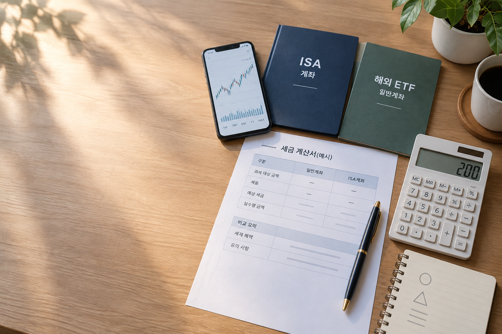

이 그림에서 봐야 할 점은 ISA의 투자수익률보다 만기 뒤 돈을 어느 계좌로, 언제 옮기느냐가 세금 차이를 만든다는 사실이다.

ISA 만기자금을 연금저축이나 IRP로 옮길 사람이라면 만기일 이후 60일 안에 이체하는 선택이 유리할 수 있다. 전환금액의 10%, 최대 300만 원이 연금계좌 세액공제 한도에 추가되기 때문이다. 다만 55세 전 인출 가능성이 높거나 올해 세금을 충분히 내지 않는 사람에게는 이 혜택만 보고 이전할 이유가 약하다.

## 숫자로 보는 추가 세액공제

국세청 안내 기준으로 연금저축·IRP의 기본 세액공제 대상 납입한도는 합산 900만 원이다. ISA 만기잔액을 연금계좌에 납입하면 그 해에 한해 전환금액의 10% 또는 300만 원 중 작은 금액만큼 한도가 늘어난다. 2026년 11월 15일 확인 기준 계산은 다음과 같다.

| ISA 전환금액 | 추가 공제 대상액 | 총 세액공제 한도(기본 900만 원 납입 가정) | 총급여 5,500만 원 이하* | 초과 구간* |
|---:|---:|---:|---:|---:|
| 1,200만 원 | 120만 원 | 1,020만 원 | 19만 8,000원 | 15만 8,400원 |
| 2,500만 원 | 250만 원 | 1,150만 원 | 41만 2,500원 | 33만 원 |
| 3,000만 원 이상 | 300만 원 | 1,200만 원 | 49만 5,000원 | 39만 6,000원 |

*소득세율 15%·12%에 지방소득세 효과를 반영해 16.5%·13.2%로 계산한 가상 사례다. 실제 환급액은 결정세액과 다른 공제 항목에 따라 줄어들 수 있다.

## 이전 비용은 세금과 따로 계산한다

ISA 안의 ETF를 매도해 현금으로 옮겨야 한다면 매도 수수료와 매수 수수료가 생길 수 있다. 예를 들어 전환금액 3,000만 원, 매도·매수 수수료를 각각 0.015%라고 가정하면 3,000만 원 × 0.03% = 9,000원이다. 이는 금융회사별 실제 요율이 아니라 비용 계산을 위한 가정이다. 매매차익 과세, 환전 비용, 결제일에 따른 이체 지연은 상품과 금융회사 조건을 따로 확인해야 한다.

| 확인 항목 | 판단 기준 |
|---|---|
| 60일 | ISA 계약기간 만료일부터 60일 이내 연금계좌에 납입 |
| 추가 한도 | 전환금액의 10%, 최대 300만 원 |
| 기본 한도 | 연금저축·IRP 합산 900만 원 |
| 비용 | 상품 매도·매수, 환전, 계좌별 이체·거래 수수료 |
| 회수 위험 | 연금 외 방식으로 꺼내면 세액공제분과 운용수익에 세금이 붙을 수 있음 |

## 이전 전에 확인할 체크리스트

- ISA 만기일과 실제 현금화 완료일을 확인한다.
- 연금저축과 IRP 중 어디에 넣을지 정한다. IRP는 위험자산 비중과 중도인출 제한을 함께 확인한다.
- 올해 이미 납입한 연금계좌 금액과 결정세액을 계산한다.
- ETF를 팔아야 한다면 매도·매수·환전 수수료를 합산한다.
- 만기일로부터 60일 안에 납입됐다는 금융회사 처리내역을 보관한다.

국세청은 ISA 만기 전환금액의 추가 한도는 실제로 ISA 만기잔액을 연금계좌에 납입한 과세기간에 적용한다고 안내한다. 만기 직전이나 60일이 지난 뒤의 일반 납입은 같은 혜택으로 계산하면 안 된다. 금융회사 안내는 [국세청 연금소득 안내](https://www.nts.go.kr/nts/cm/cntnts/cntntsView.do?cntntsId=7885&mi=6605)와 [우리은행 ISA 안내](https://spot.wooribank.com/pot/Dream?withyou=POCNT0140)를 함께 확인하는 편이 안전하다.

핵심은 3,000만 원을 옮겨야만 유리한 것이 아니라, 실제 이전금액의 10%와 최대 300만 원 중 작은 금액만 추가된다는 점이다. 연금으로 오래 유지할 수 있고 올해 세금에서 공제받을 여지가 있을 때만 매매·이체 비용까지 빼고 판단해야 한다.
